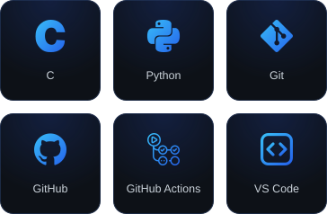
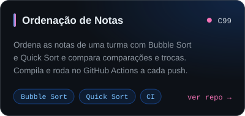
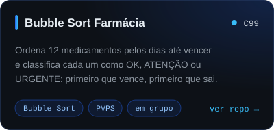
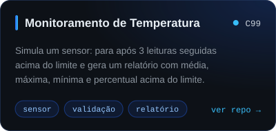
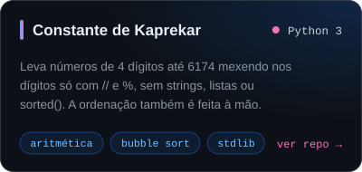
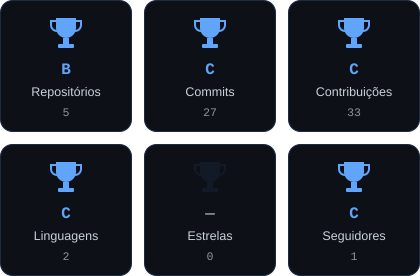

<!-- ============ BANNER ============ -->
<p align="center">
  
</p>

<!-- ============ DIGITAÇÃO ============ -->
<p align="center">
  <a href="https://github.com/rian-ribeiro-dev">
    
  </a>
</p>

<p align="center">
  <a href="https://www.linkedin.com/in/rian-do-nascimento-ribeiro-310a27433/"></a>
  <a href="https://github.com/rian-ribeiro-dev"></a>
  
</p>

<p align="center"></p>

## `01` sobre mim

Oi, eu sou o **Rian**. Estou no 2º semestre de **Engenharia de Software na UDF**, e quase tudo o que você vai encontrar aqui nasceu em sala de aula: exercícios de algoritmos escritos em C e Python que eu fiz questão de transformar em repositórios de verdade, com README, licença e, quando faz sentido, um workflow no GitHub Actions compilando e rodando o código a cada push.

Meu foco é **backend**. Ainda estou no começo, então prefiro mostrar o que já construí do que listar o que pretendo aprender. O que dá pra ver nos projetos: validação de entrada, comparação de algoritmos de ordenação contando comparações e trocas, e cuidado em deixar cada repositório fácil de rodar por outra pessoa.

Estou procurando meu **primeiro estágio em TI**, e não estou preso a uma área só. Se tiver espaço pra aprender com gente mais experiente, me interessa.

```txt
curso      Engenharia de Software · UDF
semestre   2º  (conclusão prevista para 2029)
foco       backend
agora      algoritmos, estruturas de controle e Python
procura    estágio em TI, qualquer área
```

<p align="center"></p>

## `02` tecnologias

<p align="center">
  
</p>

<div align="center">

| linguagens | ferramentas |
| :--: | :--: |
| Python | Git · GitHub · GitHub Actions (CI/CD) · VS Code |

<sub>nível acadêmico: cada item dessa lista aparece em pelo menos um dos meus repositórios.</sub>

</div>

<p align="center"></p>

## `03` projetos

<p align="center">
  <a href="https://github.com/rian-ribeiro-dev/ordena-o-notas"></a>
  <a href="https://github.com/rian-ribeiro-dev/bubble-sort-farmacia"></a>
  <a href="https://github.com/rian-ribeiro-dev/monitoramento-temperatura-c"></a>
  <a href="https://github.com/rian-ribeiro-dev/constante-kaprekar-python"></a>
</p>

<p align="center"><sub>clique em um card para abrir o repositório</sub></p>

<p align="center"></p>

## `04` estatísticas

<p align="center">
  
  
</p>

<p align="center">
  
</p>

<p align="center">
  
</p>

<p align="center">
  
</p>

<p align="center"></p>

## `05` contribuições

<p align="center">
  <picture>
    <source media="(prefers-color-scheme: dark)" srcset="https://raw.githubusercontent.com/rian-ribeiro-dev/rian-ribeiro-dev/output/github-snake-dark.svg" />
    <source media="(prefers-color-scheme: light)" srcset="https://raw.githubusercontent.com/rian-ribeiro-dev/rian-ribeiro-dev/output/github-snake.svg" />
    
  </picture>
</p>

<p align="center"></p>

## `06` contato

<p align="center">
  Se você tem uma vaga de estágio, uma dica ou quer comentar algum projeto, pode me chamar.
</p>

<p align="center">
  <a href="https://www.linkedin.com/in/rian-do-nascimento-ribeiro-310a27433/"></a>
  <a href="https://github.com/rian-ribeiro-dev"></a>
  <a href="https://www.instagram.com/rian.ribeiro__/"></a>
</p>

<details>
<summary><sub>📊 Relatório: benchmarking de perfis no GitHub (Etapa 1)</sub></summary>

<br />

Para organizar meu perfil, segui e analisei 10 perfis de referência: [@torvalds](https://github.com/torvalds), [@gaearon](https://github.com/gaearon), [@yyx990803](https://github.com/yyx990803), [@sindresorhus](https://github.com/sindresorhus), [@addyosmani](https://github.com/addyosmani), [@kentcdodds](https://github.com/kentcdodds), [@ThePrimeagen](https://github.com/ThePrimeagen), [@diego3g](https://github.com/diego3g), [@maykbrito](https://github.com/maykbrito) e [@filipedeschamps](https://github.com/filipedeschamps).

O padrão mais forte que percebi é que **menos é mais**: profissionais como Linus Torvalds, Dan Abramov e Evan You quase não têm texto no perfil, e quem fala por eles são os repositórios fixados, com nomes curtos e descritivos que deixam claro o que cada projeto faz. Já os perfis com Profile README, como os de Sindre Sorhus, Kent C. Dodds e Addy Osmani, apresentam a pessoa em poucas linhas e direcionam o visitante para os principais trabalhos e canais de contato. Os desenvolvedores brasileiros, como Diego Fernandes e Mayk Brito, usam badges de forma pontual para mostrar a stack sem poluir a página. Nos repositórios em destaque, notei um padrão de documentação bem consistente: README com visão geral do problema, instruções de instalação, exemplos de uso e imagens ou GIFs de demonstração. Também ficou claro que licenças como a MIT e arquivos `.gitignore` bem estruturados são padrão em projetos sérios, porque mostram cuidado com reutilização e segurança do código. Por fim, o histórico de contribuições constante e a participação em organizações e projetos open source mostram disciplina, algo que um iniciante também pode construir com commits frequentes. Com base nisso, me espelhei nessas práticas: escrevi uma apresentação curta em formato de história, mapeei minha stack com badges organizados por categoria, padronizei os nomes dos repositórios em letras minúsculas separadas por hífen, fixei meus melhores trabalhos (com os projetos deste semestre no topo) e documentei cada um com visão geral, tecnologias, passo a passo de execução, captura de tela, licença MIT e `.gitignore`.

</details>

<br />

<!-- ============ RODAPÉ ============ -->
<p align="center">
  
</p>

<p align="center">
  
</p>
